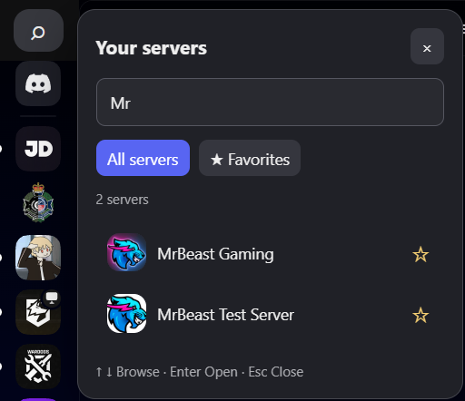
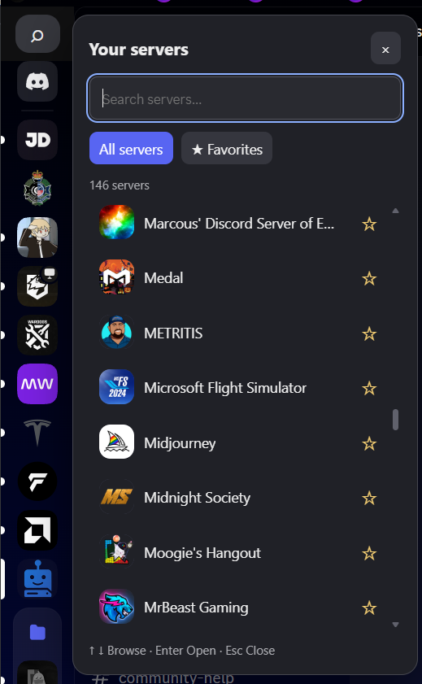

# BD – ServerSearch

Search your Discord servers from a dedicated sidebar panel, with server icons and a saved Favorites filter.

**Experimental BetterDiscord plugin · Version 1.1.1 · Personal project by [sutto4](https://github.com/sutto4)**

## Preview

Type to filter your server list, or switch to saved favorites.



<details>
<summary>View the full server list</summary>



</details>

## Features

- Search all joined servers, including servers inside collapsed folders.
- Case- and accent-insensitive name matching. Multiple search words must all match.
- Alphabetical results with static server icons and initials as a fallback.
- Star servers and filter to your favorites.
- Keyboard navigation and a sidebar search button.
- Open servers through Discord's internal navigation, without a page-reload fallback.

The plugin filters its own panel; it does not hide or reorder the native server sidebar.

## Download and install

Requires the Discord desktop client with [BetterDiscord](https://betterdiscord.app/) already installed. Mobile and unmodified Discord are not supported.

1. [Download ServerSearch.plugin.js](https://github.com/sutto4/BD-ServerSearch/raw/refs/heads/main/ServerSearch.plugin.js).
2. In Discord, open **User Settings → BetterDiscord → Plugins → Open Plugins Folder**.
3. Copy the downloaded file into that folder. Keep the exact `ServerSearch.plugin.js` filename.
4. Enable **ServerSearch** in the plugin list.

No build step or additional plugin library is needed. If your browser displays the source, save it as `ServerSearch.plugin.js`, not as HTML or a `.txt` file.

## Usage

Click the search button above the server sidebar, or use the shortcut below. Type a server name, then click a result to open it. Click ☆ to save a favorite and ★ to remove it; select **Favorites** to filter the list.

| Control | Action |
| --- | --- |
| Ctrl+Shift+S / Cmd+Shift+S | Open or close the panel |
| Up / Down | Move through results |
| Enter | Open the focused server, or the first result from the search field |
| Escape | Close the panel |
| Tab / Shift+Tab | Move between controls |

Search text clears each time the panel opens. The All/Favorites selection lasts until the plugin restarts. Favorites persist across restarts.

## Updating and removal

Replace the existing plugin file with the latest download, then toggle the plugin off and on if needed. Do not keep multiple copies installed. Version 1.1.1 preserves favorites saved by earlier versions.

There is no built-in automatic updater. Check this repository for updates.

To remove the plugin, disable it and remove its `.plugin.js` file. BetterDiscord may retain its separate local settings file; removing the plugin alone does not erase saved favorite IDs.

## Native alternative

Discord already provides server search: press **Ctrl+K** (Cmd+K on macOS), then type `*` followed by a server name. You do not need this plugin for basic server navigation. ServerSearch adds a visible sidebar entry point and a saved Favorites filter. See [Discord's Quick Switcher guide](https://support.discord.com/hc/en-us/articles/115000070311-Quick-Switcher).

## Privacy

- Reads server names, IDs and icon hashes already available in Discord's local server store.
- Stores favorite server IDs locally using BetterDiscord's Data API.
- Search queries are handled locally and are not saved by this plugin.
- Loads icon images from Discord's CDN; those image requests reveal the requested icon and ordinary connection information to Discord.
- No analytics, external backend, token collection, message reading or background account automation.

## Compatibility and troubleshooting

Discord's internal modules and page structure can change without notice. Custom themes and other plugins may also affect the panel.

| Problem | What to try |
| --- | --- |
| Search button missing | Use Ctrl+Shift+S. A Discord update or theme may have changed the sidebar structure. |
| No results | Clear the search and select All servers. The plugin only lists servers you have joined. |
| Initials instead of an icon | The server has no icon, its image is still loading, or the image request failed. |
| Navigation error | Check for a plugin update. The panel stays open if internal navigation cannot be found or fails; it will not fall back to reloading Discord. |
| Discord reloads when selecting a server | Confirm you have version 1.1.1 and no older duplicate copies. |
| Layout or shortcut conflict | Temporarily disable other plugins/themes to identify the conflict. |

Automated checks use mocked Discord/BetterDiscord APIs. They do not prove compatibility with a live Discord build. The latest navigation fix still needs live-client confirmation.

Report reproducible bugs through [GitHub Issues](https://github.com/sutto4/BD-ServerSearch/issues). Include plugin, Discord and BetterDiscord versions, operating system, steps to reproduce, and expected/actual behavior. Remove private server names, IDs, tokens and personal information from logs or screenshots. Support is best effort.

## Platform notice

This is an unofficial personal project, not affiliated with or endorsed by Discord or BetterDiscord. It has not been submitted to or approved for BetterDiscord's plugin directory.

Discord's [Terms of Service](https://discord.com/terms) prohibit unauthorized software designed to modify its services. Using a modified client may put your account at risk; this project makes no assurance about enforcement.

## Development

The complete distributable is `ServerSearch.plugin.js`; there is no bundler or dependency installation.

With Node.js installed:

```sh
node --check ServerSearch.plugin.js
node tests/test.cjs
```

See [CONTRIBUTING.md](CONTRIBUTING.md) for test coverage and manual checks, and [CHANGELOG.md](CHANGELOG.md) for version history.
